# Smart Glove App 3.0 protocol

Bluetooth Classic SPP, HC-05/HC-06 UART at 9600 baud, 8N1. This is a local engineering protocol, without authentication, end-to-end checksums, or a guarantee of lossless delivery. Pair only the intended glove. Firmware does not read commands from USB Serial.

## Sensor frames

```text
thumb,index,middle,ring,pinky,grip\n
12,28,40,33,18,642\n
```

Exactly six decimal integers. Fingers are normalized movement values `0..90` using independent two-point calibration, not certified anatomical joint angles. Grip is **filtered ADC**, `0..1023`; this preserves the meaning of earlier stored maximum-grip values. Baseline-corrected grip delta is used internally for haptics and displayed on the OLED. Grip is not a force measurement in newtons.

Nominal transmission is 10 Hz. Control replies have priority: firmware skips telemetry rather than accumulating stale frames. Sampling continues during calibration, saving, and transmission. Invalid calibration produces zero finger movement values and disables automatic haptics; app recording requires valid calibration and an idle calibration workflow.

Frames end with LF. The app also accepts CRLF. Transport chunks are not frame boundaries. The app bounds its line buffer at 2048 bytes and drops damaged/oversized lines through the next LF. ACK/ERR/EVT lines never contribute to live-sensor freshness, history, or session metrics.

## Commands

Case-sensitive, no spaces or newline inside commands. Firmware accepts at most 31 characters between markers. A partial command times out after 250 ms without another byte. Bytes outside markers are ignored; a new `<` restarts capture and reports malformed input. Oversized/nonprintable input is rejected through `>`; subsequent commands can recover.

| Payload | Effect |
|---|---|
| `VIB:ALL,0` / `VIB:ALL,1` | All motor requests off/on; selects MANUAL |
| `VIB:1,0` through `VIB:5,1` | One finger request, exact target `1..5`, exact state `0` or `1`; selects MANUAL |
| `MODE:AUTO` | Clear manual requests and use automatic requests |
| `MODE:MANUAL` | Clear manual requests; enter manual with all requested off |
| `CAL:OPEN` | Start 64-sample open-hand/unloaded-grip capture |
| `CAL:CLOSED` | Capture bent values after successful open capture |
| `CAL:SAVE` | Validate and journal candidate calibration; acknowledge after write/readback |
| `CAL:RESET` | Journal an invalid/default record; all motors off; recalibration required |
| `CAL:CANCEL` | Discard candidate and return to previous active calibration; not accepted during EEPROM save |
| `STATUS` / `CAL:STATUS` / `PING` | Report firmware state and refresh manual-control lease |

Finger order: `1` thumb, `2` index, `3` middle, `4` ring, `5` pinky. ON commands are rejected while any targeted motor needs safety rearming. All commands are rejected as busy while saving, except a retry of the same sequenced save.

Legacy syntax remains accepted:

```text
<VIB:ALL,1>
<VIB:3,0>
<MODE:AUTO>
<CAL:OPEN>
```

New app syntax adds a request ID:

```text
<Q:42:VIB:3,1>
<Q:43:STATUS>
```

IDs are decimal `1..65535`, at most five digits. App uses increasing IDs, retaining its counter across reconnects. ID `0` in responses means unsequenced/legacy or framing/link errors. Only **one sequenced command may be outstanding**. Firmware caches the most recent ID, payload and response. Retrying that ID/payload does not restart a motor timer, calibration, or EEPROM write. Reusing that ID for a different payload returns `ID_REUSE`. This is not a multi-command replay cache or exactly-once delivery across power loss. Repeated STATUS reports current state; repeated motor/mode ACKs update their effective output mask.

The app makes up to three attempts with the same ID. Each response timer is 850 ms after write/flush. Retries add 38/51 ms offsets and may wait up to 130 ms for a receive window after the next complete sensor frame. Expected total failure indication is approximately 2.6–3.1 seconds, plus native transport write/flush time (bounded to one second per attempt). A stalled native write/flush fails the command and closes the connection to prevent later queued writes from being reused. A timeout means **unknown delivery/output**, not proof that a command was rejected. Disconnect cancels pending commands; commands are not replayed automatically onto a reconnected glove.

## Responses

All responses are comma-separated, ASCII, LF terminated. `mask` is an integer `0..31`; bit 0 is thumb, bit 4 pinky. It reports firmware GPIO output state, not independently measured motor motion.

```text
ACK,id,VIB,target,state,mask
ACK,id,MODE,AUTO|MANUAL,mask
ACK,id,CAL,OPEN|CLOSED,STARTED
ACK,id,CAL,SAVED|RESET|CANCELLED
ACK,id,STATUS,3.0,AUTO|MANUAL,valid,phase,saved,mask
ERR,id,topic,reason
```

`valid` / `saved`: `0` or `1`. `valid` describes active calibration; `saved` describes its valid persisted state. During a new capture, previous calibration can remain valid/saved while candidate values are incomplete. `phase`: `IDLE`, `OPEN`, `CLOSED`, `OPEN_READY`, `READY`, `SAVING`, `FAILED`. Only IDLE plus valid calibration permits recording in upgraded mode.

Known error topics/reasons:

| Topic | Reasons |
|---|---|
| CMD | `UNKNOWN`, `BAD_ID`, `ID_REUSE`, `BUSY`, `MALFORMED`, `OVERSIZED`, `INCOMPLETE` |
| VIB | `BAD_TARGET`, `BAD_STATE`, `CALIBRATING`, `REARM_REQUIRED` |
| CAL | `BUSY`, `OPEN_REQUIRED`, `INVALID_SPAN`, `EEPROM` |
| LINK | `RX_OVERFLOW`, `TX_OVERFLOW` (ID 0) |

```text
EVT,VIB,finger,TIMEOUT,mask
EVT,OUTPUT,mask
EVT,LINK,LEASE_EXPIRED,0
EVT,CAL,OPEN|CLOSED,DONE|UNSTABLE
EVT,CAL,CLOSED,INVALID_SPAN
```

Capture ACK confirms **start**, not completion. EVT reports completion/error; periodic STATUS recovers state if an event is missed. Save/reset ACK confirms EEPROM readback. Motor ACK reports the effective output after applying the request. Subsequent timeout/output events and STATUS supersede earlier ACK state. Automatic output events are coalesced at the telemetry interval; timeout events are queued by finger with the latest output mask.

## Haptic state and safety

```mermaid
stateDiagram-v2
    [*] --> AUTO: motors off; load calibration
    AUTO --> MANUAL: MODE:MANUAL or valid VIB command
    MANUAL --> AUTO: MODE:AUTO
    MANUAL --> MANUAL: VIB changes manual requests
```



Automatic request per finger: ON at normalized bend >=40, OFF at <=15, retain within the band; grip-active requests all five ON. Grip activates at baseline delta >=80 and deactivates at <=40. These are tuning defaults in `glove_core.h`, not universal sensor or clinical thresholds.

Effective outputs are inhibited throughout any non-IDLE calibration workflow. Each motor has a 1000 ms maximum continuous ON duration, followed by a latched trip. Rearm requires a released request and at least 2000 ms since trip. In AUTO, release bend/grip below the OFF thresholds; in MANUAL, send OFF, wait, then ON. Mode switches and repeated commands cannot extend ON time or clear a trip. Startup initializes motor pins OFF before peripherals. The firmware is cooperative: limit enforcement can be delayed by bounded loop/interrupt work; measure that delay on hardware.

MANUAL has a 3000 ms lease refreshed by accepted VIB/mode/status/ping traffic. Without refresh it clears manual requests and reports lease expiry. App polls STATUS once per second when no command is pending. A fresh command is needed to resume after expiry. AUTO operates locally without the phone. No physical Bluetooth STATE pin is connected, so this lease indicates app activity, not the module's exact connection state.

## Timing limitations and legacy use

SoftwareSerial cannot receive and transmit simultaneously. A byte takes about 1.04 ms at 9600; the longest sensor line is 20 bytes including LF. Firmware transmits one byte per loop and pauses while receiving a marked command. This bounds blind intervals but does not eliminate collisions at the first byte. OLED writes are incremental, at 100 kHz with bounded Wire timeouts. Target rates are soft real-time; qualify actual jitter, retries and frame loss using the bench guide.

An old app can read new sensor frames and send unchanged VIB commands, but does not gain confirmations/calibration UI. A new app connected to older firmware shows live readings, but requires explicit **Settings → Use legacy firmware** to permit legacy sessions/commands. Legacy mode is reset on disconnect. A glove that has confirmed the upgraded protocol cannot select legacy mode during that connection. It preserves six-field recording semantics and sends exact old VIB bytes, without asserting confirmed motor state or newer safety guarantees. A missing status ACK never automatically enables legacy mode.
